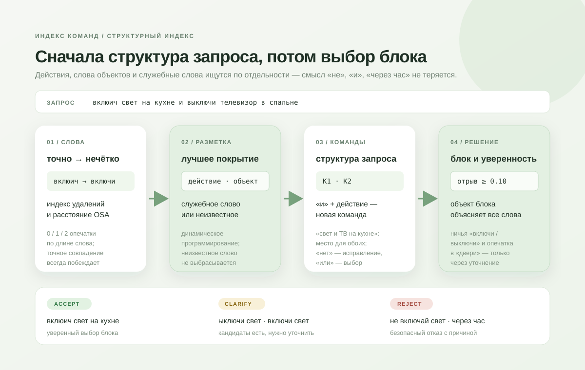

# Алгоритмы платформы

Один алгоритм — один Python-модуль в этой папке. Его единственная обязательная функция:

```python
def search(query: str, blocks: list[dict]) -> list[dict]:
    ...
```

Она принимает строку запроса и список смысловых блоков. У каждого блока есть `index` (целое число), `text` и, возможно, `actions` и `objects`.

Функция возвращает ранжированный список словарей. Три поля обязательны:

```python
{
    'index': 7,              # индекс исходного смыслового блока
    'text': 'включи кухонный свет',  # конкретная сыгравшая формулировка
    'score': 0.94,           # число от 0 до 1; больше — лучше
}
```

Четыре поля необязательны. Их можно не возвращать вовсе; если они есть, платформа проверяет формат и показывает их в интерфейсе:

```python
{
    'decision': 'accept',    # решение по всему запросу: accept | clarify | reject
    'status': 'resolved',    # статус команды, к которой относится блок (см. ниже)
    'command': 1,            # номер команды в запросе, если их несколько
    'explain': ['«вклюич» → «включи»: перестановка букв'],  # почему блок здесь
}
```

| `decision` | смысл |
|---|---|
| `accept` | можно выбирать уверенно |
| `clarify` | есть кандидаты, но нужно уточнение у пользователя или следующего компонента |
| `reject` | безопасный отказ: отрицание, время, незнакомое место или объект, нет такого блока |

`status`: `resolved`, `ambiguous`, `incomplete`, `incompatible`, `not_found`, `negated`, `unsupported`. Любые другие поля платформа отбрасывает.

Платформа проверяет этот контракт перед отправкой данных в интерфейс. Общие утилиты находятся в [shared.py](shared.py). После создания модуля добавьте одну запись в [config.py](config.py): `id`, `name`, `description`, `module` и `function`. `main.py` менять не нужно. Оценить новый метод на датасете — [evaluation/README.md](../evaluation/README.md).

## Что уже есть

| id | модуль | идея |
|---|---|---|
| `levenshtein-combinations` | [levenshtein_combinations.py](levenshtein_combinations.py) | Левенштейн по всем формам «действие + объект» и «объект + действие» |
| `tfidf-char` | [tfidf_char.py](tfidf_char.py) | косинус по символьным 3-граммам с весами IDF через инвертированный индекс |
| `structured` | [structured.py](structured.py) | действия, объекты и служебные слова по отдельности; несколько команд, отрицание, безопасный отказ |
| `structured-morph` | [structured.py](structured.py), `search_morph` | то же плюс сравнение слов по лемме через pymorphy3 |

В [shared.py](shared.py), кроме нормализации и Левенштейна, лежат `tokens` (слова запроса с запятыми), `osa` (Левенштейн с перестановкой соседних букв) и `DeletionIndex` — нечёткий поиск слова через индекс удалений. Их можно использовать в любом алгоритме.

## Как работает `structured`



1. **Словарь из блоков.** Фразы действий (`включи`, `поставь`), слова объектов (`свет`, `кухне`, `люстру`) и тексты специальных команд. Строится один раз на содержимое каталога и пересобирается после любой правки блока.
2. **Слова запроса.** Каждое слово ищется точно; если точного совпадения нет — через `DeletionIndex` с расстоянием `osa`: 0 опечаток для слов до 3 букв, 1 — до 7, 2 — для длинных. Точное совпадение всегда побеждает: «включи» никогда не читается как опечатка «выключи».
3. **Покрытие.** Динамическое программирование выбирает лучшую разметку слов: действие, слово объекта, специальная команда, служебное слово («и», «или», «не», «нет», «в», «через», «кроме»…) или неизвестное слово.
4. **Структура.** «и» перед действием начинает новую команду. «и»/«или» между объектами — сочинение. «в/на …» после однородных объектов относится ко всем: «включи свет и телевизор на кухне». «… и в спальне» — тот же объект в другом месте. «нет» — самоисправление: остаётся то, что сказано после него. Эллипсис: «включи свет на кухне, а в спальне выключи» — у второй команды только место, объект («свет») берётся из предыдущей.
5. **Объект по словам.** Блок подходит, если его объект объясняет все слова упоминания. «свет» подходит трём комнатам — это неполное название и повод уточнить; «свет в гараже» не подходит никому — слово «гараже» не теряется молча. Разрывное действие: объект «на паузу» (начинается с предлога) или «громче», «тише», «теплее» (у блока есть и «сделай», и форма без действия) — это состояние, а не устройство; если остальные слова ровно образуют объект другого блока («музыку», «телевизор в гостиной»), это цель действия — «поставь музыку на паузу», «сделай музыку громче» без отдельных aliases. Самостоятельная команда без действий («отмена») состоянием не считается. Для обычных объектов так не делаем: «выключи музыку свет на кухне» не склеивается молча.
6. **Незнакомые слова** зависят от места. До первого действия или объекта — обращение («привет», «алиса», «слушай»): пропускается с пометкой в `explain`. Сразу после «в/на» — место, которого нет в каталоге («в гараже»): отказ `not_found`. В команде без распознанного объекта незнакомое слово считается объектом («включи чайник»): тоже отказ. Остальные — лишние слова внутри команды («включи свет быстро»): кандидат есть, но нужно уточнение, потому что такое слово может менять смысл. Слова «тоже», «ещё», «также» — заполнители, как «пожалуйста».
7. **Решение.** Уверенно — только если лучший блок опережает второй на `MARGIN = 0.10`. Ничья противоположных действий после опечатки, «или», противоречие («открой и закрой») — уточнение. Отрицание, время, «всё/кроме» — безопасный отказ. Для осторожных объектов (`CAREFUL`: дверь, холодильник…) опечатка никогда не даёт уверенного выбора.
8. **Подсказка при пустом ответе.** Если у команды (или у всего запроса) нет ни одного кандидата — например, «открой шторы на кухне», а штор на кухне нет, или объект незнаком («открой форточку»), — метод отдаёт до трёх похожих формулировок от `tfidf_char` с близостью ≥ `HINT_MIN = 0.5`: решение остаётся `reject`, статус `not_found`, в `explain` — «может, вы имели в виду…». Структура и безопасность — от структурного индекса, полнота — от TF-IDF.

Скорость: ~0.2–0.4 мс на запрос на примере из 44 блоков (Левенштейн по комбинациям — ~80 мс).

## Леммы: `structured-morph`

Пословный поиск не терпит окончаний: «откройте» отличается от «открой» на две буквы, это больше допустимой опечатки, и слово становится незнакомым. Перечислять в блоках все формы («лампу, лампа, лампы, лампой…») неудобно, а писать свою морфологию — значит повторять готовые словари. `structured-morph` берёт начальные формы из [pymorphy3](https://github.com/no-plagiarism/pymorphy3) (словари OpenCorpora) и сравнивает слово запроса со словами каталога по лемме:

1. точное совпадение слова — как раньше;
2. иначе та же лемма: «откройте» → «открыть» ← «открой». Совпадение формы считается точным (без штрафа), в `explain` — «другая форма слова»;
3. иначе — поиск опечаток, как раньше.

Две защиты, чтобы морфология не обошла безопасность:

- лемма берётся только у слов, известных словарю. Для «выключа» pymorphy угадал бы лемму по похожим словам, и опечатка могла бы обойти ничью «включи / выключи»;
- леммы применяются только к словам действий и объектов, не к спецкомандам: «далеко» и «дальше» — формы одного слова «далёкий».

Разница на датасете (тип «словоформа», 14 запросов): `structured` — 0.857 (четыре глагола на «-те» не распознаны), `structured-morph` — 1.000; на остальных типах результаты одинаковы. Задержка не меняется: леммы кэшируются (`lru_cache`), сам разбор слова — около 0.1 мс.
