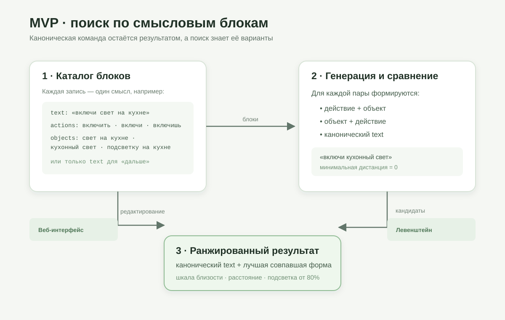

# Схемы MVP

Эти схемы отражают текущую модель проекта и служат кратким визуальным объяснением для команды.

## Что реализовано

Команда хранится как смысловой блок с обязательным каноническим `text` и необязательными списками `actions` и `objects`. Поиск строит все пары `действие + объект` и `объект + действие`, добавляет канонический текст и выбирает форму с минимальным расстоянием Левенштейна. Пользователь видит каноническую команду и, если нужно, форму, которая лучше всего совпала с запросом.

Например, блок с `text: «включи свет на кухне»` и объектом `«кухонный свет»` даст нулевую дистанцию для запроса «включи кухонный свет».

Стартовый каталог находится в [backend/app/catalog.py](../backend/app/catalog.py). Он хранится в JSON-файле Docker volume после изменений через интерфейс.

## Граница текущей версии

Блоки «включить свет» и «зажечь свет» пока равноправны и не получают отдельной связи синонимов. Местоположение остаётся частью объекта: «свет на кухне» — единая строка. Параметры вроде времени будильника и выполнение самой команды находятся за пределами MVP.
