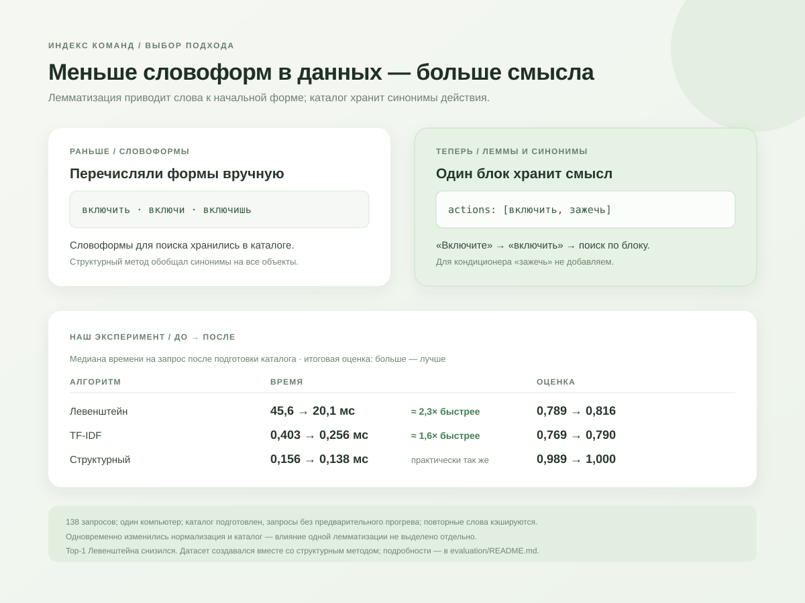

# Схемы платформы

Эти схемы служат кратким визуальным объяснением для команды. Сравнение ниже относится к эксперименту объединённой версии на 138 запросах.

## Что показывают схемы

- `data-model.svg` — формат смыслового блока: обязательный `text` и необязательные массивы `actions` и `objects`.
- `lemmatization-comparison.svg` — сравнение версии коллеги с объединённой схемой, лемматизацией и синонимами на 138 запросах.
- `algorithm-contract.svg` — стабильный контракт каждого метода: `search(query, blocks)` возвращает ранжированный массив с `index`, `text`, `score` и необязательными `decision`, `status`, `command`, `explain`.
- `structured-algorithm.svg` — четыре шага метода `structured` (слова, разметка, команды, решение) и три исхода: уверенный выбор, уточнение, безопасный отказ.

Стартовый каталог находится в [backend/app/catalog.py](../backend/app/catalog.py). Он хранится в JSON-файле Docker volume после изменений через интерфейс.

## Граница текущей версии

Синонимы действия задаются внутри блока и зависят от объекта: свет можно включить или зажечь. Явные группы противоположных действий используются структурным алгоритмом для выявления опасной неоднозначности. Местоположение остаётся частью объекта: «свет на кухне» — единая строка. Параметры вроде времени будильника и выполнение самой команды находятся за пределами текущей версии.
